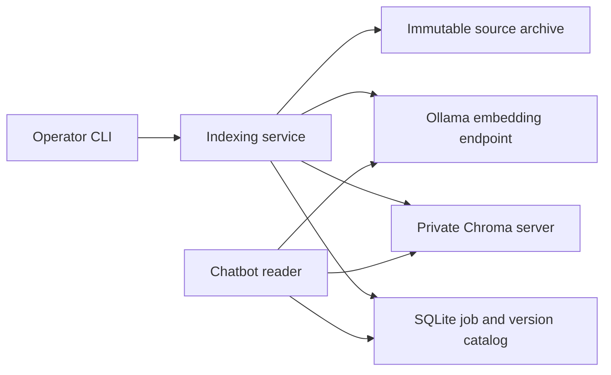

# TANSY production indexing design

Date: 16 October 2026 (Asia/Calcutta).

Status: proposed specification for owner review. The VPS direction is approved; this written specification has not yet been approved. Implementation and deployment have not started.

## 1. Outcome and scope

Build a dependable indexing service for TANSAM's production chatbot. An operator must be able to add or replace approved documents through a stable interface, with no application code edits. The chatbot must continue using its published knowledge while a replacement is being built, and failed builds must preserve that published version.

The current target is one Linux VPS with durable local storage. Hostinger is the intended provider, but provider-specific paths and service addresses must remain configuration. A future move between VPS providers should be a configuration and data-migration task. Horizontal deployment across multiple application hosts would require a shared catalog and distributed coordination; it is not claimed to work merely by changing an address.

This phase implements indexing, publication, status, recovery, rollback, and the minimal reader integration necessary to select a published version. Retrieval ranking, hybrid search, reranking, conversational query rewriting, answer-grounding policy, public upload endpoints, authentication UI, and the knowledge-management frontend remain later phases.

The approved TANSAM facts remain unchanged. No Board or Skilling material is added. The existing non-contact sections and approved contact corrections remain the source baseline.

### Review summary

- Build complete immutable index versions; publish only after verification.
- Keep the existing version available on parsing, embedding, storage, or publication failure.
- Retain the current and previous published versions for rollback.
- Use private server-backed Chroma in production, with a SQLite catalog and writer coordination on the single VPS.
- Store source revisions, approval records, embedding profiles, job outcomes, and publication history durably.
- Expose the same indexing operations through a CLI now and a callable Python service for a future admin interface.
- Develop each behavior through the requested failing-test, implementation, and passing-test cycle.

## 2. Current evidence and migration baseline

Inspection on 16 October found:

- `backend/ingest_tansam.py` deletes source records before generating replacements.
- `backend/services/rag.py` constructs an embedded Chroma client and a global `documents` collection during import.
- `backend/config.py` uses a launch-directory-dependent `chroma_db` path.
- The standard ingestion function uses random IDs and records only owner/source metadata.
- The currently populated database has 16 document records, 768-dimensional embeddings, and a passing SQLite integrity check.
- Current source SHA-256: `569c271aad5f732a2990577361d4e8a7395aca7c002ad30dfbda92208223a592`.
- All 16 current records carry that source hash and approval date `2026-10-16`, added during the controlled update rather than by the original ingestion script.
- The current embeddings were generated by the legacy plain-text input path. Their original model digest was not recorded, so it cannot be inferred retroactively.
- The existing JavaScript baseline has 17 passing tests, with Vite port-24678 conflict warnings. There is no Python indexing test suite yet.

Existing knowledge and database backups must be retained during migration. New integration tests use isolated stores, never the live database as their test fixture.

## 3. Design choices

| Approach | Benefit | Limitation | Decision |
| --- | --- | --- | --- |
| Replace records in the active collection | Fewest stored copies | A multi-batch replacement can expose partial knowledge and complicates rollback | Reject for published updates |
| Build a complete collection per knowledge-base revision, then switch a catalog pointer | Simple publication boundary, reproducible versions, easy rollback | Copies unchanged vectors into each snapshot and requires capacity management | Select for the current small knowledge base |
| Per-document active versions with distributed jobs | More efficient at much larger scale | More complicated consistency, coordination, and recovery | Defer until workload evidence justifies it |

Reuse cached embeddings for unchanged chunks under the identical embedding profile. Full-snapshot publication does not require repeatedly asking Ollama to embed unchanged content.

## 4. Runtime components

- **Indexing service:** orchestrates validation, extraction, chunking, embedding, staging, verification, and publication. It is callable without importing Flask or starting a web server.
- **Source archive:** stores approved original bytes and manifests under content-addressed filenames. Display filenames are metadata, not filesystem paths constructed from user-controlled names.
- **Embedding client:** handles the configured Ollama endpoint, model identity, input batching, timeouts, retry policy, and vector validation.
- **Vector store:** uses `HttpClient` against a private Chroma server in production. Embedded or ephemeral stores are explicit development/test modes. Production configuration must not silently fall back to an embedded or empty database.
- **Catalog:** uses a dedicated SQLite file, separate from Chroma's internal files. It records sources, revisions, jobs, profiles, active-version pointers, and activation events.
- **Coordination:** a process-safe advisory file lock per knowledge base, shared by all index writers and publication commands on the VPS. The catalog uses transactions and generation checks for publication.
- **Reader integration:** resolves a published revision and its profile at request time. It does not retain an import-time collection forever or create a missing collection automatically.

Ollama may run on the same VPS or on a separate compute server through configuration. Source archives, catalog, cache, and vector persistence belong on durable storage, independently of the inference machine's lifetime.

## 5. Inputs and approval contract

The public build input is a versioned JSON manifest describing the complete intended source set for one knowledge base. Each source has a stable logical `source_id`, path, display name, declared format, approved SHA-256, approval time, and approver label. The manifest also identifies the knowledge base and owner scope.

The initial source set contains only the approved `tansam_knowledge.txt`. Adding a supported document requires a manifest change and indexing commands, not Python code edits. Different source IDs may use the same basename; a duplicate source ID is rejected. Removing a source requires an explicit retirement entry naming the source and reason; an accidentally omitted source must not disappear silently.

The source hash must match approved bytes before processing. Read bytes once into the archive and process that immutable copy, so changing a file during a build cannot mix content revisions. Persist archive/report files through flushed temporary files and atomic rename; complete the Linux filesystem durability steps before catalog references are committed. Record original bytes and extracted text hashes separately. Preserve source facts; extraction must not summarize or generate new factual content.

This phase trusts authenticated operating-system access to the private CLI. An approver label is audit metadata, not authentication or a cryptographic signature. A later admin API must authenticate and authorize callers before invoking the same service; no unauthenticated mutation endpoint is introduced here.

Supported formats in this phase are UTF-8 TXT, UTF-8 Markdown, and PDFs containing extractable text. Reject unsupported formats, invalid UTF-8, encrypted/unreadable PDFs, and documents without useful extracted text. Scanned PDFs require OCR and receive a clear unsupported-input result rather than a successful empty index.

Proposed initial configurable limits:

| Limit | Default |
| --- | --- |
| Sources in one manifest | 100 |
| Raw bytes per source | 10 MiB |
| Combined raw bytes per build | 100 MiB |
| Pages per PDF | 200 |
| Extracted characters per source | 1,000,000 |
| Total chunks per build | 20,000 |
| Extraction time per document | 60 seconds |
| Total build deadline | 30 minutes |

These are admission limits, not throughput promises. Validate configured limits and available storage before starting. PDF extraction runs in a separate process with a hard timeout; production worker/container memory limits provide the additional memory boundary.

## 6. Chunk and embedding contracts

Chunking is deterministic and versioned. Retain section headings for Markdown and recognizable knowledge-file headings; preserve paragraph boundaries where possible. Split long sections within a configured character bound and add overlap within the same section, without losing source text. Record source ID, source hash, section, page where available, and chunk ordinal. Do not claim that a character limit is a token limit.

Initial chunk settings are a 1,000-character body target and 150-character overlap, with a versioned heading-prefix policy. Overlap must be nonnegative and smaller than the target. Whitespace normalization is deterministic and documented. Tests use hand-checked fixtures to verify coverage, Unicode handling, boundaries, and section/page provenance.

A stable chunk ID derives from source identity, content hash, chunk ordinal, and processing-profile fingerprint. The fingerprint covers parser/chunker versions and every setting that changes embedded text or vector interpretation. Operational settings such as retry delay do not create a new semantic profile.

The embedding profile records model name/tag, resolved model digest, dimensionality, document/query input policy, normalization policy, distance metric, and embedding API version. New Nomic retrieval profiles use the documented `search_document: ` and `search_query: ` prefixes after confirming the installed model's identity. Legacy unprefixed vectors must never be relabelled as that new profile.

Use Ollama `/api/embed` with bounded arrays and `truncate=false`. An oversized input must fail explicitly rather than silently losing text. Start with batches of 16 inputs and one in-flight embedding request per indexing job; both bounds are configurable. Chroma writes are also bounded by the server's supported batch size.

Before accepting an embedding batch, verify the response shape, item count, numeric values, finite values, nonzero vector norm, and consistent expected dimension. Resolve model identity at build start and verify it before each embedding batch and before publication. Operators must not overwrite the pinned model during a job. A changed model identity causes failure and requires an explicit profile rebuild; a same-name or same-dimension model is not automatically compatible.

Cache keys include the entire embedding-profile fingerprint and exact embedded-input hash. Validate cached vectors before reuse; mismatching or corrupted entries are not silently accepted. Changes to chunking, task-prefix policy, or embedding identity invalidate affected cache entries.

## 7. Build and job lifecycle

1. Validate configuration and manifest, acquire the knowledge-base writer lock, and capture the expected active generation.
2. Validate approvals and bytes, archive the immutable source set, and compute the processing fingerprint.
3. Record an `unchanged` job and reuse a verified current revision when the source/approval set and profile are identical. A matching verified ready revision may also be reused if its expected base generation is still current. No new embedding requests or vector records are created. A stale ready revision cannot bypass the current-source-set checks.
4. Persist a job and staging revision, then extract, chunk, and embed. Reuse compatible cached vectors.
5. Write a new uniquely named Chroma collection. Never write into a published collection. Disable implicit default embedding functions: all vectors are provided explicitly.
6. Read back the staged records in bounded pages. Verify exact expected IDs, counts, document hashes, source/approval/profile metadata, and vector validity. A count alone is insufficient.
7. Record a durable verification report and mark the revision `ready`. Build success does not publish automatically.
8. Release the writer lock. An operator can inspect and explicitly publish the ready revision.

Jobs have durable states `running`, `ready`, `unchanged`, `failed`, and `interrupted`, with phase, timestamps, progress counts, and a stable error code. They also record the base generation and source/profile fingerprints. The active pointer, rather than a mutable `published` job state, determines which verified revision is serving.

The first runner is a synchronous CLI process separated from Flask request handling. A callable service provides the operations a future background worker/admin interface will consume. A distributed queue and continuously running scheduler are outside this phase.

## 8. Publication, concurrency, and readers

`publish` acquires the same per-knowledge-base writer lock, checks that the chosen revision is ready and still verifiable, and starts a short SQLite write transaction. The transaction compares the expected generation, updates the active revision, increments the generation, and records the actor/reason and activation event together. Publication and rollback carry stable operation IDs; repeating an operation with the same ID and identical arguments returns its recorded outcome, while changing the arguments under that ID is rejected. Publication does not perform a destructive vector replacement.

If another publication or rollback changed the generation, reject the stale publish. The operator must review and rebuild against the current source set; there is no force-publish override in this phase. A busy writer receives a clear conflict result, not a second competing build.

Each chat retrieval pins one catalog revision/profile for that lookup and queries only its immutable collection. It embeds the query according to that profile, not whichever global model setting was changed most recently. Profile compatibility is checked; incompatible models, absent published collections, or unavailable storage produce an explicit unavailable/error result. They must not silently select another collection or trigger an ungrounded model answer.

The public streaming chat response shape remains compatible for successful requests. Before streaming starts, an unavailable index/profile returns a controlled HTTP 503 JSON error and does not invoke answer generation. This phase does not add similarity thresholds, change ranking, rewrite queries, or redesign normal answer generation.

After publication, the next request sees the new revision without restarting Flask. Requests already using the prior revision can finish because the previous collection is retained. Neither publication nor rollback deletes any published collection. Automatic garbage collection is deferred; archived revision removal requires a separate documented maintenance window with readers and writers stopped. Disk-capacity checks must reject new builds before they threaten retained data.

## 9. Failure recovery, retries, and rollback

- Retry connection failures, timeouts, rate limits, and explicitly transient server errors with bounded exponential backoff and jitter. Default maximum is three attempts total, within the build deadline. Do not retry invalid input, incompatible profiles, malformed vectors, or ordinary permanent client errors.
- Retry vector writes only against the job's staging collection with deterministic IDs and idempotent upserts. An uncertain network response must not create duplicates. Never interpret a single upsert as an atomic whole-index publication.
- A source, embedding, cache, disk, or verification error leaves the active pointer untouched. Persist a diagnostic when storage is available, emit a nonzero CLI exit status, and retain staging evidence for inspection.
- A terminated process releases the operating-system lock. `recover` obtains that lock and marks abandoned running jobs interrupted. It cannot mark a live locked job interrupted. Recovery starts a new staging build using the archive/cache and does not publish an uncertain partial collection.
- If publication commits but the CLI loses its connection or is interrupted, the activation event and active pointer are authoritative. Repeating the same already-completed publication is reported safely; it must not create another conflicting activation.
- Rollback revalidates an existing retained revision and its embedding profile, then uses the same generation-checked transaction and audit event. It never rewrites source files or pretends an unavailable embedding model is usable.

## 10. Storage, configuration, and operations

Store catalog, immutable sources/manifests, verification reports, cache, and lock files under one explicitly configured durable application data root. Resolve development defaults relative to the backend module, never the caller's working directory. In production, require an absolute data-root path and explicit Chroma/Ollama endpoints. Keep configuration and credentials in runtime environment settings; omit them from logs and source control.

Use SQLite WAL, `synchronous=FULL`, foreign keys, explicit transactions, a bounded busy timeout, and a schema version. Catalog schema migration is deliberate and backed up. The catalog is on the VPS's local durable filesystem, not an NFS share and not copied from Chroma internals. Multiple Flask processes on that VPS may read it; one coordinated indexing writer operates per knowledge base. Moving to multiple application hosts requires replacing this coordination/catalog deployment with a shared service.

The production Chroma service is private to the application network and owns its persistent volume. The public browser reaches the Flask API over HTTPS, not Chroma or Ollama directly. A remote inference endpoint needs a protected connection. Indexing runs as a separate operator/worker process so long builds do not occupy Flask request workers.

Use reproducibly pinned Python dependencies and matching Chroma client/server versions. Record installed versions and model identity in build reports. The current local baseline is Python 3.11, Chroma 1.5.9, requests 2.32.5, pypdf 6.12.1, and filelock 3.19.1. The production Linux environment must be tested separately; local installation alone is not compatibility evidence.

Emit structured logs containing job ID, knowledge base, revision, phase, elapsed time, progress, cache hits, retry count, and error code. Avoid full source text, vectors, secrets, or chat histories in routine logs. `status` and `verify` report active revision, profile, source count, chunk count, and readiness. Dependency failure or catalog/collection mismatch must be visible to operators.

Back up source archives, manifests, catalog, profile records, reports, and cache to storage outside the VPS. Obtain catalog backups with SQLite's consistent backup mechanism while index writes are coordinated. Do not copy a live Chroma SQLite file as a server backup. A full Chroma volume backup follows a supported quiesced snapshot procedure; alternatively restore a verified snapshot from archived sources/cache. Test recovery in an isolated environment before deployment acceptance.

No automatic cleanup deletes active or rollback collections. Initial deployment documentation must include disk monitoring, failed-build inspection, backup/restore steps, and a maintenance procedure for old revision removal. Retaining multiple snapshots has a deliberate storage cost.

## 11. Public interfaces and future administration

The callable service exposes `validate`, `build`, `status`, `verify`, `publish`, `recover`, and `rollback`, with typed results and stable error codes. The CLI is a thin adapter to those operations and supports machine-readable JSON output and meaningful nonzero failures. The existing `ingest_tansam.py` becomes a compatibility entrypoint for the safe operations; it no longer deletes current records first or publishes implicitly.

A future authenticated admin interface can upload supported documents, collect approval, call these operations, show progress, and publish approved versions. The indexing engine must not depend on a browser session or Flask request context. New file formats, an OCR engine, scheduled external-source synchronization, and a distributed job broker remain explicit extensions rather than silently accepted inputs.

## 12. Migration from the current index

1. Preserve the current knowledge file and the existing pre-update backup. Verify its source hash and the 16-record `documents` collection before migration.
2. Keep the legacy store untouched while producing a candidate in the new server-backed store. Inventory every legacy source/owner; unexpected content must be reported, not discarded.
3. Copy and verify the existing vectors/documents/metadata into a baseline legacy collection without relabelling its missing model digest or changing its plain-text input policy. Capture the operator-verified installed model identity as a migration-time observation, not proof of historical provenance. Require a baseline compatibility smoke check before accepting it for rollback.
4. Build a fresh revision from the approved source under the complete new profile, including the explicit model identity and input policies. Changes to chunk count are expected if chunking changes; document coverage and approved facts must remain intact.
5. Verify the candidate, inspect known contact/lab questions, and test publication plus rollback in the isolated staging environment. Cut over to the server-backed store/catalog only after those checks pass. Keep the original embedded store and the verified server-side baseline as recovery material.
6. Production deployment is a separately approved action after code, migration tooling, tests, backup/restore, and environment checks pass. Do not automatically migrate or reset data on Flask import/startup.

If the legacy model's compatibility cannot be established, retain its original store for explicit deployment rollback rather than declaring it a valid new-profile revision. Its absence must not block building a correctly profiled fresh index from the approved source, but it must be recorded as a migration acceptance limitation.

## 13. TDD boundaries and acceptance criteria

Use the explicitly requested `superpowers:test-driven-development` workflow. Develop one observable behavior at a time: write a failing test, verify the expected failure, implement only that behavior, run it green, and refactor while preserving tests. Tests and necessary fixtures ship with the implementation; adjust ignore rules narrowly so the new backend tests are version-controlled.

Use standard-library `unittest` for the Python suite. Test the callable service and CLI as public boundaries; verify results through the published-reader interface. Use real temporary catalogs and Chroma stores. Deterministic local HTTP fixtures exercise the external Ollama boundary and failures without requiring a model for every test. A separate integration suite must exercise a real Chroma HTTP server and a live local Ollama model. No test may initialize, modify, or reset the production data directory.

| Acceptance behavior | Failure the test must catch |
| --- | --- |
| Same effective configuration from root, backend, and another working directory | Launch-directory-dependent storage |
| Unsupported, unreadable, empty, unapproved, changed-after-approval, oversized, encrypted, or timed-out documents fail safely | Bad inputs becoming successful or partial published knowledge |
| Deterministic chunk coverage and provenance, including long sections, Unicode, and PDF pages | Dropped text, incorrect boundaries, or misleading source metadata |
| Malformed, incomplete, zero, nonfinite, truncated, or wrong-dimension embeddings cannot produce a ready revision | Invalid vectors reaching publication |
| An embedding failure after earlier batches leaves the prior published answers available | Delete-before-replacement loss |
| Partial vector writes and read-back mismatches leave the active version unchanged | Partially populated publication |
| Unchanged builds make no new embeddings; changed input/profile cannot reuse incompatible vectors | Duplicate work and invalid cache reuse |
| A timeout after a successful staging write can be retried without duplicate records | Non-idempotent retries |
| A concurrent writer is rejected; stale publication and rollback fail generation checks | Conflicting writers and lost updates |
| Process termination leaves an interrupted staging job; recovery preserves published answers | Crash-time data loss or uncertain publication |
| Termination around activation yields either the old or fully verified new revision | Half-published versions |
| Repeated operation IDs return the original outcome and reject changed arguments | Duplicate or ambiguous publication after a lost response |
| Requests pin a profile/revision and subsequent requests see publication without restart | Mixed-profile lookup or stale global collection |
| Draft, failed, interrupted, and unapproved revisions cannot be retrieved | Visibility leaks from staging |
| Rollback restores a verified retained source set without deleting the newer one | Destructive or incompatible rollback |
| Model identity changes fail publication/query compatibility checks | Same-name model drift |
| Backup restore reproduces a known published revision in isolation | Unusable recovery material |
| Chroma, catalog, and worker process restarts preserve the verified published version | Reliance on process-local state or nonpersistent storage |
| Legacy migration preserves all approved facts and the original recovery store | Silent migration loss |

Run the Python suite in the current Windows development environment, the existing `npm test` suite, scoped static checks, and Linux server-backed integration tests before claiming implementation complete. The operating-system lock, subprocess recovery, and storage paths need coverage on both development and production platforms. Record failures and inherited warnings explicitly. Also verify that the protected five-section source hash is unchanged and Board/Skilling additions remain absent.

Production acceptance additionally requires the actual VPS plan/resource review, persistent volumes and restart checks, protected network connections, a backup/restore exercise, and measured indexing resource usage while representative chat traffic is running. Hardware sizing and public-chat throughput remain measured deployment decisions, not promises in this specification.

## 14. Review status and next stage

This specification is the artifact for owner review. Approval authorizes writing the implementation plan; that plan will define the execution sequence, test slices, file changes, migration commands, and verification steps before development starts. TDD remains required during execution.

Self-review checks: scope separates indexing from retrieval-quality/admin work; VPS assumptions and multi-host limits are explicit; staged writes and catalog publication have one defined visibility boundary; legacy provenance is not fabricated; acceptance criteria test observable behavior; no application implementation or live index mutation is included in this documentation change.

## References

- [Chroma Python clients](https://docs.trychroma.com/reference/python/client): production server-backed clients and explicit development/test clients.
- [Chroma record updates](https://docs.trychroma.com/docs/collections/update-data): idempotent record upserts; whole-index publication remains an application contract.
- [Ollama embedding API](https://docs.ollama.com/api/embed): batch input and disabling silent truncation.
- [Ollama embeddings guidance](https://docs.ollama.com/capabilities/embeddings): consistent indexing/query model usage.
- [Nomic embedding model instructions](https://huggingface.co/nomic-ai/nomic-embed-text-v1.5): distinct document and query task prefixes.
- [Hostinger VPS/GPU comparison](https://www.hostinger.com/support/how-to-choose-between-a-hostinger-vps-and-gpu-instance/): persistent application data versus optional GPU computation.
- Local source review: `docs/chatbot/knowledge-base-audit-2026-10-13.md` and `docs/chatbot/knowledge-update-2026-10-16.md`.
